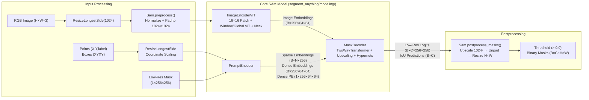
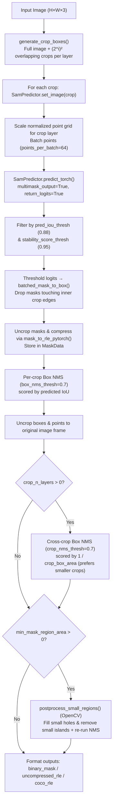

# Segment Anything (SAM) — Architecture

## 1. Overview

**Segment Anything (SAM)** is a promptable image segmentation system designed around a decoupled two-stage architecture:

1. **Heavyweight Image Encoder (amortized per image):** A Vision Transformer (`ImageEncoderViT`) computes a single `256 × 64 × 64` spatial embedding for an input image resized to longest side `1024`.
2. **Lightweight Prompt Encoder & Mask Decoder (per prompt):** Encodes sparse prompts (points, boxes) and dense prompts (low-resolution masks) and predicts high-resolution object masks plus IoU quality scores in milliseconds.

This separation enables three primary execution modes in this repository:
- **Interactive Prompted Prediction** (`SamPredictor`): Compute image embeddings once, then run repeated low-latency mask predictions as prompts change.
- **Automatic Whole-Image Mask Generation** (`SamAutomaticMaskGenerator`): Prompt SAM across a dense grid of points (optionally over multi-scale overlapping image crops) and filter/deduplicate predictions.
- **Edge / In-Browser Inference** (`SamOnnxModel` + `demo/`): Export only the prompt encoder, mask decoder, and mask postprocessing to ONNX for execution in `onnxruntime` or `onnxruntime-web` (WebAssembly) using precomputed image embeddings.

---

## 2. Repository Structure

```text
segment-anything/
├── segment_anything/                 # Core Python package
│   ├── __init__.py                   # Public exports: builders, registry, SamPredictor, SamAutomaticMaskGenerator
│   ├── build_sam.py                  # Model factory functions (vit_h, vit_l, vit_b) & sam_model_registry
│   ├── predictor.py                  # Stateful interactive predictor (SamPredictor)
│   ├── automatic_mask_generator.py   # Whole-image mask generation pipeline (SamAutomaticMaskGenerator)
│   ├── modeling/                     # Neural network modules
│   │   ├── sam.py                    # Top-level Sam nn.Module (preprocess, forward, postprocess_masks)
│   │   ├── image_encoder.py          # ViTDet-adapted Vision Transformer backbone (ImageEncoderViT)
│   │   ├── prompt_encoder.py         # Sparse/dense prompt encoder & random Fourier positional encodings
│   │   ├── mask_decoder.py           # Transformer-based mask & IoU prediction head (MaskDecoder)
│   │   ├── transformer.py            # Bidirectional token/image attention (TwoWayTransformer)
│   │   └── common.py                 # Shared MLPBlock and channel-first LayerNorm2d
│   └── utils/                        # Supporting utilities
│       ├── transforms.py             # ResizeLongestSide for images, points, and boxes
│       ├── amg.py                    # MaskData container, RLE encoding, stability score, cropping, postprocessing
│       └── onnx.py                   # Trace-friendly SamOnnxModel wrapper for ONNX export
├── scripts/                          # CLI entrypoints
│   ├── amg.py                        # Batch CLI for automatic mask generation (PNG+CSV or COCO RLE JSON)
│   └── export_onnx_model.py          # CLI for ONNX export, ORT validation, and QUInt8 dynamic quantization
├── demo/                             # Front-end-only React + TypeScript + onnxruntime-web demo
│   ├── configs/webpack/              # Dev/prod Webpack configs (COOP/COEP headers for SharedArrayBuffer)
│   └── src/                          # App, Stage, Tool, ONNX input/mask helpers, React context
├── notebooks/                        # Interactive usage examples (predictor, AMG, ONNX)
├── setup.py / setup.cfg              # Packaging and isort configuration
└── linter.sh                         # Code quality checks (isort, black, flake8, mypy)
```

---

## 3. System Architecture & Data Flow



---

## 4. Core Neural Architecture (`segment_anything/modeling/`)

### 4.1 Top-Level Container (`sam.py`)

`Sam(nn.Module)` composes `image_encoder`, `prompt_encoder`, and `mask_decoder`, and owns image normalization and mask resizing:

- **Preprocessing (`preprocess`)**: Normalizes RGB pixels using ImageNet statistics (`pixel_mean=[123.675, 116.28, 103.53]`, `pixel_std=[58.395, 57.12, 57.375]`) and zero-pads the bottom and right edges to `1024 × 1024`.
- **End-to-End Forward (`forward`)**: Runs `image_encoder` on a stacked batch of preprocessed images, then iterates per image record to encode prompts, decode masks, postprocess, and threshold at `mask_threshold = 0.0`. For interactive use where prompts arrive incrementally, `SamPredictor` is used instead so `image_encoder` runs only once.
- **Mask Postprocessing (`postprocess_masks`)**:
  1. Bilinearly upscales `256 × 256` logits to `1024 × 1024`.
  2. Crops away bottom/right padding to `input_size`.
  3. Bilinearly upscales to `original_size` `(H, W)`.

### 4.2 Model Variants (`build_sam.py`)

All three checkpoints share the exact same `PromptEncoder` and `MaskDecoder` configuration (`image_size=1024`, `patch_size=16`, `image_embedding_size=64×64`, `prompt_embed_dim=256`, `window_size=14`, `num_multimask_outputs=3`). They differ only in the `ImageEncoderViT` backbone:

| Registry Key | Builder | `embed_dim` | `depth` | `num_heads` | Global Attention Block Indexes |
| :--- | :--- | :---: | :---: | :---: | :--- |
| `vit_b` | `build_sam_vit_b` | 768 | 12 | 12 | `[2, 5, 8, 11]` |
| `vit_l` | `build_sam_vit_l` | 1024 | 24 | 16 | `[5, 11, 17, 23]` |
| `vit_h` / `default` | `build_sam_vit_h` | 1280 | 32 | 16 | `[7, 15, 23, 31]` |

### 4.3 Image Encoder (`image_encoder.py`)

`ImageEncoderViT` is adapted from ViTDet and transforms `B × 3 × 1024 × 1024` inputs into `B × 256 × 64 × 64` feature maps:

1. **`PatchEmbed`**: Non-overlapping `16 × 16` convolution (stride `16`), yielding a `64 × 64` spatial token grid (`B × 64 × 64 × embed_dim`).
2. **Absolute Positional Embedding**: Learnable `1 × 64 × 64 × embed_dim` parameter added to patch tokens.
3. **Transformer `Block` Stack**:
   - Most layers partition the `64 × 64` grid into non-overlapping `14 × 14` windows (`window_partition` / `window_unpartition` with padding) to keep attention cost linear in image area.
   - Four evenly spaced layers (`global_attn_indexes`) run full global attention across all `64 × 64` tokens.
   - Every `Attention` layer adds **decomposed 2D relative positional embeddings** (`add_decomposed_rel_pos`, adapted from MViTv2) along height and width axes.
4. **Convolutional Neck**: Permutes to `B × embed_dim × 64 × 64` and applies `Conv2d(embed_dim → 256, k=1)` → `LayerNorm2d` → `Conv2d(256 → 256, k=3, p=1)` → `LayerNorm2d`.

### 4.4 Prompt Encoder (`prompt_encoder.py`)

`PromptEncoder` maps heterogeneous user prompts into a shared `256`-dimensional embedding space aligned with the `64 × 64` image embedding:

- **Positional Encoding (`PositionEmbeddingRandom`)**: Projects normalized coordinates in `[0, 1]²` (mapped to `[-1, 1]²`) through a fixed Gaussian frequency matrix `positional_encoding_gaussian_matrix` of shape `(2, 128)`, then concatenates `sin(2π·xB)` and `cos(2π·xB)` to form `256`-dim Fourier features. `get_dense_pe()` generates this encoding for the `64 × 64` image grid.
- **Sparse Prompts (Points & Boxes)**:
  - Coordinates are shifted by `+0.5` to pixel centers and encoded with `PositionEmbeddingRandom`.
  - Learned type embeddings (`point_embeddings[0..3]` and `not_a_point_embed`) are added per token type:
    - Label `0`: background point
    - Label `1`: foreground point
    - Label `-1`: padding ("not a point") — automatically appended when points are supplied without a box
    - Box corners: reshaped to 2 points per box, summed with top-left (`point_embeddings[2]`) and bottom-right (`point_embeddings[3]`) embeddings.
  - Concatenated into `sparse_embeddings` of shape `B × N × 256`.
- **Dense Prompts (Masks)**:
  - Input masks of shape `B × 1 × 256 × 256` are downscaled 4× via `mask_downscaling` (`Conv2d(1→4, k=2, s=2)` → `LayerNorm2d` → `GELU` → `Conv2d(4→16, k=2, s=2)` → `LayerNorm2d` → `GELU` → `Conv2d(16→256, k=1)`) to `B × 256 × 64 × 64`.
  - When no mask is provided, a learned `no_mask_embed` (`1 × 256`) is broadcast to `B × 256 × 64 × 64`.

### 4.5 Mask Decoder & Two-Way Transformer (`mask_decoder.py`, `transformer.py`)

`MaskDecoder` fuses image embeddings and prompt embeddings to predict masks and quality scores:

1. **Token Assembly**: Concatenates `[iou_token (1), mask_tokens (4), sparse_prompt_embeddings (N)]` into `tokens` (`B × (5 + N) × 256`). The 4 mask tokens correspond to 1 single-mask output (index `0`) and 3 disambiguating multimask outputs (indices `1..3`).
2. **Dense Fusion**: Repeats the `1 × 256 × 64 × 64` image embedding across the prompt batch dimension `B` and adds `dense_prompt_embeddings` element-wise.
3. **`TwoWayTransformer`** (depth `2`, `8` heads, `mlp_dim=2048`, `attention_downsample_rate=2` for cross-attention):
   - Each `TwoWayAttentionBlock` performs four sub-layers:
     1. Self-attention on prompt/output tokens (skipping PE on layer 0).
     2. Cross-attention: tokens attending to image embeddings.
     3. Pointwise MLP (`256 → 2048 → 256`, `ReLU`) on tokens.
     4. Cross-attention: image embeddings attending to tokens.
   - Followed by a final token-to-image cross-attention layer and `LayerNorm`.
4. **Dynamic Mask Prediction & IoU Head**:
   - Updated image tokens are reshaped to `B × 256 × 64 × 64` and upscaled 4× via `output_upscaling` (two stride-2 `ConvTranspose2d` layers with `LayerNorm2d` and `GELU`) to `B × 32 × 256 × 256`.
   - Each of the 4 updated `mask_tokens_out` passes through its own 3-layer hypernetwork `MLP(256 → 256 → 32)`.
   - Matrix multiplication `hyper_in @ upscaled_embedding` produces `B × 4 × 256 × 256` low-resolution mask logits.
   - `iou_token_out` passes through `iou_prediction_head` (`MLP(256 → 256 → 4)`, 3 layers) to predict per-mask IoU quality scores.
   - `forward()` slices index `0:1` when `multimask_output=False`, or indices `1:4` when `multimask_output=True`.

### 4.6 Shared Primitives (`common.py`)

- `MLPBlock`: Two-layer feed-forward network (`Linear → act → Linear`) used in both ViT blocks (`GELU`) and `TwoWayAttentionBlock` (`ReLU`).
- `LayerNorm2d`: Channel-first 2D LayerNorm (adapted from ConvNeXt / Detectron2) operating over the `C` dimension of `B × C × H × W` tensors.

---

## 5. High-Level Inference APIs

### 5.1 Interactive Predictor (`predictor.py`)

`SamPredictor` wraps a `Sam` instance for stateful, low-latency interactive prompting:

- `set_image(image, image_format="RGB")` / `set_torch_image(...)`: Resizes the image with `ResizeLongestSide(1024)`, normalizes/pads via `Sam.preprocess`, runs `image_encoder`, and caches `self.features` (`1 × 256 × 64 × 64`), `self.original_size`, and `self.input_size`.
- `predict(...)` / `predict_torch(...)`: Transforms prompt coordinates/boxes from original image space to resized model space, runs `prompt_encoder` + `mask_decoder` against the cached `self.features`, and upscales masks back to `original_size`. Returns `(masks, iou_predictions, low_res_masks)`, where `low_res_masks` (`C × 256 × 256`) can be fed back as `mask_input` for iterative refinement.
- `get_image_embedding()`: Exposes the cached `1 × 256 × 64 × 64` embedding tensor (e.g., for saving `.npy` embeddings for ONNX/web inference).

### 5.2 Automatic Mask Generator (`automatic_mask_generator.py` & `utils/amg.py`)

`SamAutomaticMaskGenerator` segments all objects in an image without user prompts by combining dense point grids, optional multi-scale image cropping, quality filtering, RLE compression, and NMS:



Key utilities in `segment_anything/utils/amg.py`:
- **`MaskData`**: Dictionary-like batch container supporting synchronized `filter()`, `cat()`, and `to_numpy()` across `torch.Tensor`, `np.ndarray`, and Python `list` fields.
- **`calculate_stability_score`**: Computes the IoU between binary masks thresholded at `mask_threshold + offset` and `mask_threshold - offset` directly on logits.
- **`mask_to_rle_pytorch` / `rle_to_mask` / `coco_encode_rle`**: PyTorch-based Fortran-order uncompressed RLE encoding to keep memory usage bounded across hundreds of masks, with optional `pycocotools` compressed COCO RLE conversion.
- **`remove_small_regions`**: Uses `cv2.connectedComponentsWithStats` to remove small holes and disconnected islands; in `postprocess_small_regions`, unchanged masks receive higher NMS priority (`score=1.0`) than modified ones (`score=0.0`).

### 5.3 Coordinate & Image Transforms (`utils/transforms.py`)

`ResizeLongestSide(target_length=1024)` computes aspect-ratio-preserving target dimensions (`get_preprocess_shape`) and provides matching NumPy and PyTorch transforms for images (`apply_image`), point coordinates (`apply_coords`), and XYXY boxes (`apply_boxes`).

---

## 6. ONNX Export & Web Demo

### 6.1 Trace-Friendly ONNX Wrapper (`utils/onnx.py` & `scripts/export_onnx_model.py`)

Because `ImageEncoderViT` is computationally heavy and runs once per image, SAM exports only the prompt encoder, mask decoder, and mask postprocessing via `SamOnnxModel`:

- **Inputs**:
  - `image_embeddings`: `(1, 256, 64, 64)` float32 (precomputed by `ImageEncoderViT`)
  - `point_coords`: `(1, num_points, 2)` float32 (dynamic axis 1)
  - `point_labels`: `(1, num_points)` float32 (dynamic axis 1; unified label space: `-1` padding, `0` background, `1` foreground, `2` box top-left, `3` box bottom-right)
  - `mask_input`: `(1, 1, 256, 256)` float32
  - `has_mask_input`: `(1,)` float32 (`0` or `1`)
  - `orig_im_size`: `(2,)` float32 (`[H, W]`)
- **Branchless Graph Design**:
  - `_embed_points` uses boolean indicator multiplication instead of in-place indexing.
  - `_embed_masks` linearly blends `mask_downscaling(input_mask)` and `no_mask_embed` using `has_mask_input`.
  - `select_masks` (when `--return-single-mask` is set) selects between the single-mask token and multimask tokens without Python control flow by adding `(num_points - 2.5) * [1000, 0, 0, 0]` to scores before `argmax`.
- **Export Options (`scripts/export_onnx_model.py`)**: Supports configurable `--opset` (default `17`), `--gelu-approximate` (`tanh` approximation for runtimes with slow `erf`), `--use-stability-score`, `--return-extra-metrics`, automatic `onnxruntime` CPU smoke-testing, and `--quantize-out` dynamic `QUInt8` quantization.

### 6.2 Front-End Web Demo (`demo/`)

A standalone React + TypeScript application demonstrating real-time in-browser segmentation with `onnxruntime-web` (WASM backend with SIMD128 and Web Worker multithreading via `SharedArrayBuffer`, enabled by `Cross-Origin-Opener-Policy: same-origin` and `Cross-Origin-Embedder-Policy: credentialless` headers in `demo/configs/webpack/dev.js`):

- **`App.tsx`**: Loads the quantized ONNX model (`InferenceSession.create`), the source image (`handleImageScale` computes `samScale = 1024 / max(H, W)`), and the precomputed `.npy` embedding (`npyjs`). Triggers `model.run(feeds)` whenever `clicks` updates in `AppContext`.
- **`Stage.tsx`**: Captures throttled (`15ms`) mouse-move/touch events, maps viewport coordinates back to natural image coordinates, and updates `clicks` in `AppContext`.
- **`helpers/onnxModelAPI.tsx`**: Scales clicks by `samScale`, appends the required `(0, 0)` / label `-1` padding point (when no box is present), and constructs the 6 ONNX input tensors.
- **`helpers/maskUtils.tsx` & `Tool.tsx`**: Thresholds the returned mask logits at `> 0.0`, converts them into a blue RGBA `ImageData` → `<canvas>` → `HTMLImageElement`, and overlays it at 40% opacity on top of the responsive image.

---

## 7. CLI Scripts, Packaging & Tooling

- **`scripts/amg.py`**: CLI wrapper around `SamAutomaticMaskGenerator` supporting single images or directories, exposing all AMG hyperparameters, and writing either per-image folders of binary PNGs + `metadata.csv` or COCO RLE `.json` files (`--convert-to-rle`).
- **`scripts/export_onnx_model.py`**: CLI for exporting and optionally quantizing `SamOnnxModel`.
- **Dependencies (`setup.py`)**: Core package requires only PyTorch and TorchVision (`python>=3.8`, `pytorch>=1.7`, `torchvision>=0.8`); optional extras (`[all]`) add `matplotlib`, `pycocotools`, `opencv-python`, `onnx`, and `onnxruntime`.
- **Code Quality (`linter.sh`, `setup.cfg`, `.flake8`)**: Enforces `isort` (line length 100), `black -l 100`, `flake8`, and `mypy --exclude 'setup.py|notebooks' .`.
